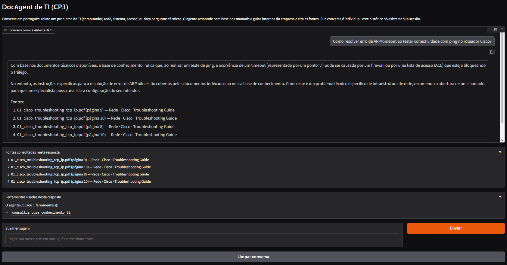
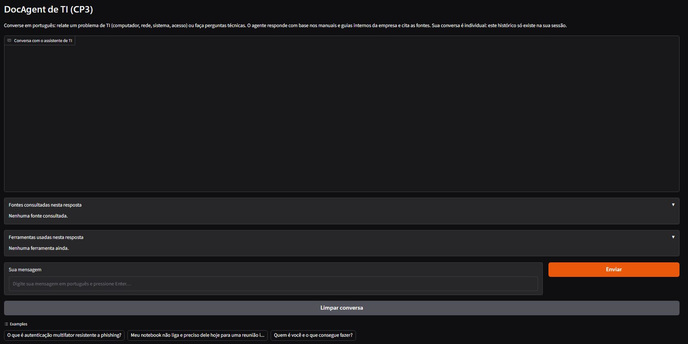

# CKP03 — Agente de triagem de TI (ReAct + AgentExecutor)

**Prompt Engineering & AI · FIAP · 2º Semestre 2026**

> **Relação com as demais CPs:** esta é a documentação da CP3 (branch `cp3`). A CP1 (chatbot base) está documentada na branch `cp1` e a CP2 (RAG) na branch `cp2`; Este checkpoint mantém as ENTREGAS da CP1 e CP2 intactas (`app/` e `rag/` sem mudanças de comportamento).

**Integrantes:**

| Nome | RM |
|---|---|
| Gustavo Kunitaki | 571400 |
| Pedro Ferreras | 568713 |
| Pedro Santos | 571017 |
| Victor Binot | 571499 |

## Domínio

**Domínio:** triagem e suporte técnico de TI corporativo — o mesmo das CP1/CP2. A base de conhecimento (PDFs reais em `docs/`) é exatamente a da CP2, agora consultada pelo agente via tool.

A CP3 transforma o pipeline RAG da CP2 em uma *tool* de um agente inteligente. O agente decide quando consultar os documentos (`rag/`, branch `cp2`), quando classificar um chamado, quando gerar checklist e quando responder sem ferramenta alguma.

**Tecnologias:** Python 3.14 (venv do projeto), LangChain 1.x (`langchain_core`) + `langchain-classic 1.0.x` (`create_react_agent` + `AgentExecutor` — motivo do uso da *classic* documentado abaixo), `gemma4:cloud` via Ollama Cloud para o LLM do agente e da tool RAG, `nomic-embed-text` (Ollama local) + ChromaDB para o RAG (reuso da CP2), Gradio 6.x para a interface web e `.env`/`python-dotenv` para a chave da Ollama Cloud.

- **Modelo de chat:** exclusivamente `gemma4:cloud` (`app/chain.py` / `rag/rag_chain.py`), via Ollama Cloud, com `OLLAMA_API_KEY` carregada de variável de ambiente (`.env`), nunca hardcoded.
- **Requisitos obrigatórios atendidos:** agente ReAct criado com `create_react_agent` e executado pelo `AgentExecutor` (com `handle_parsing_errors`, `max_iterations` e `max_execution_time`); pipeline RAG da CP2 exposto como única tool de consulta apelidada `buscar(consulta)` (input único de string, formato exigido pelo parser ReAct, em `agent/tools.py`); chat exclusivo via `gemma4:cloud`; interface web Gradio com histórico por sessão e fontes citadas; três cenários validados (RAG, outra ferramenta, sem ferramenta — seção de interações reais abaixo).
- **Arquitetura:** `langchain_classic.agents.create_react_agent` + `AgentExecutor` (ReAct). Por que `langchain_classic` e não `langchain.agents`: no ambiente deste projeto (Python 3.14 + Pydantic) o módulo legado `langchain.chains` quebra na avaliação de type hints (issue langchain-ai/langchain#33449, documentada em `app/memory_manager.py`; a mesma razão já obrigou o uso de `trim_messages` na CP1 — documentação na branch `cp1`) — a `langchain-classic` funciona e está fixada no `requirements.txt`.
- **Guardrail de entrada (bônus):** antes de qualquer ferramenta rodar, `agent/guardrail.py`
  valida a mensagem de forma heurística (regex, sem LLM e sem serviços externos): entradas
  vazias, acima de 2.000 caracteres, tentativas de prompt injection ("ignore as instruções
  anteriores", extração de system prompt/jailbreak) e assuntos claramente fora do domínio de
  TI são recusadas educadamente. Para não bloquear perguntas legítimas, a regra de domínio
  só recusa quando há marcador off-topic claro e nenhum sinal de TI — e a recusa não entra
  no histórico do agente. A validação vive na porta única do agente
  (`AgenteTriagemTI.enviar_mensagem_com_passos`, `agent/agent.py`), por isso CLI e interface
  Gradio herdam o guardrail sem duplicação; testes em `tests/test_guardrail_cp3.py`.
- **Compressão de contexto (bônus), em DOIS níveis distintos:** (1) histórico de conversa entre turnos reutilizando `aplicar_token_buffer`/`trim_messages` da CP1; (2) dentro de um mesmo turno, `agent/scratchpad_compressor.py` comprime o **scratchpad ReAct** — quando as observações acumuladas das ferramentas passam do limite (`SCRATCHPAD_LIMITE_CARACTERES`, padrão 3.000 chars), as antigas viram UMA síntese extrativa determinística (sem LLM extra) que mantém cabeças técnicas e os blocos `Fontes:` verbatim (nada de citação alucinada), e apenas a janela das mais recentes (`SCRATCHPAD_JANELA_RECENTES`, padrão 2) segue intacta; a subclasse `AgentExecutorComCompressao` injeta isso em cada iteração do loop do `AgentExecutor` sem forkar nada (só reescreve `_take_next_step`). Isso NÃO é limitar o histórico visual do Gradio; na interface, cada sessão do navegador tem agente próprio (sem misturar conversas).
- **Guardrail (comportamental):** relatos insuficientes são tratados pela tool `verificar_informacoes_minimas` e pelas regras dos prompts (sem inventar dados e sem registrar chamados em sistemas externos); o filtro de domínio da conversa é feito pelo guardrail de entrada acima.

## Ferramentas do agente (4, em `agent/tools.py`)

| # | Ferramenta | Reuso | Quando usar |
|---|---|---|---|
| 1 | `consultar_base_conhecimento_ti` (`@tool`) | Pipeline RAG da CP2 inteiro: busca UMA vez (ChromaDB + reranking), geração com o mesmo `RAG_PROMPT`/`gemma4:cloud`, resposta + seção `Fontes:` com documento/página/classificação reais. Se a base não estiver indexada, devolve as instruções de indexação da CP2 | **Dúvidas técnicas e perguntas de "como fazer"** ("como diagnosticar...", "o que recomenda para...") — qualquer coisa resolvida pelos manuais em `docs/` |
| 2 | `classificar_chamado_ti` | Saída Pydantic com categoria e prioridade (enums da CP1) e critérios explícitos de impacto/urgência | **Relato de problema com contexto suficiente** — para definir categoria (hardware/software/rede/acesso) e prioridade sugerida antes de escalar |
| 3 | `gerar_checklist_diagnostico` | Checklist seguro/ordenado; proíbe ações destrutivas e exposição de credenciais | **Autoatendimento do usuário** — quando ele quer tentar resolver antes de escalar; etapas seguras e em ordem |
| 4 | `verificar_informacoes_minimas` | Valida completude do relato; não consulta sistemas externos | **Relato vago/incompleto** ("não funciona", falta SO/erro/equipamento) — lista exatamente o que falta antes de classificar |

O agente responde SEM ferramenta em cumprimentos, perguntas sobre seu próprio papel e despedidas (prompts orientam o Final Answer direto nesses casos).

## Interações reais registradas (22/10/2026, gemma4:cloud — ambiente do projeto)

1. **Interação com RAG — pergunta:** "O que a base de conhecimento recomenda sobre autenticação anti-phishing e MFA?" → **ferramentas usadas:** `consultar_base_conhecimento_ti`. **Resultado:** resposta correta sobre phishing-resistant MFA (FIDO/WebAuthn, PKI, imunidade a SIM swap/push bombing) encerrada com "**Fontes:** 05_cisa_phishing_resistant_mfa.pdf (páginas 0, 1 e 2) — Acesso · CISA · Fact Sheet".
2. **Interação com outra ferramenta — pergunta:** "O usuário só relatou 'o computador está lento às vezes e o ponto de rede cai'. Gere um checklist de diagnóstico com etapas técnicas." → **ferramentas usadas:** `gerar_checklist_diagnostico`. **Resultado:** checklist ordenado (verificação física do cabo, reinicialização, teste de navegação em dois sites, Gerenciador de Tarefas) + perguntas de esclarecimento (SO, quando cai, mensagens de erro).
3. **Interação sem ferramenta — pergunta:** "Obrigado pela explicação! Já entendi como usar. Até mais!" → **ferramentas usadas:** nenhuma (resposta direta). **Resultado:** despedida cordial sem chamar ferramenta alguma ("Por nada! Fico feliz em ter ajudado..."), chegando direto ao Final Answer na 1ª iteração.

Validação adicional na mesma sessão: classificação ("o colaborador em home office não consegue imprimir; urgência alta e impacto médio") → `classificar_chamado_ti` → Hardware/Média/Impressora + perguntas pendentes; consultas RAG de TCP/IP citaram `01_cisco_troubleshooting_tcp_ip.pdf`, página 17; perguntas fora de domínio ("receita de bolo", "jogo do Grêmio") e uma tentativa de prompt injection foram barradas pelo guardrail de entrada antes de qualquer ferramenta; a compressão do scratchpad engatou em 2 iterações reais do executor (fluxo com 3 ferramentas) quando as observações passaram do limite configurado.

## Exemplos práticos de perguntas

1. **Agente usa o RAG:** "O que é autenticação multifator resistente a phishing?" → o agente escolhe `consultar_base_conhecimento_ti` e responde com base no `05_cisa_phishing_resistant_mfa.pdf`, citando páginas e a classificação (Acesso · CISA · Fact Sheet).
2. **Agente usa outra ferramenta:** "Meu notebook não liga e preciso dele hoje para uma reunião importante." → escolhe `verificar_informacoes_minimas`, depois `classificar_chamado_ti` (hardware/alta) e por fim `gerar_checklist_diagnostico`, sem afirmar que registrou chamado.
3. **Agente responde sem ferramenta:** "Olá, tudo bem? Quem é você e o que consegue fazer?" → Final Answer direto, sem chamadas (painel da interface mostra "Nenhuma — o agente respondeu diretamente").

## Evidências da interface Gradio (validações reais durante o desenvolvimento)

A interface foi validada de duas formas, documentadas sem alteração do código:

1. **Do servidor de desenvolvimento:** elevar o app (`python -m agent.interface_gradio`) e conversar direto em `http://127.0.0.1:7866` — resposta com fontes no painel "Fontes consultadas nesta resposta", painel "Ferramentas usadas nesta resposta" apenas com os NOMES das ferramentas (o raciocínio ReAct interno nunca é exibido), botão "Limpar conversa" e os 3 exemplos clicáveis (`gr.Examples`).
2. **De outra máquina, via `gradio_client` na URL pública `*.gradio.live`:** sessões distintas mantiveram históricos independentes (pergunta de contexto em A não "vazou" para B), "Limpar conversa" zerou tela e histórico interno (a próxima resposta ignorou a pergunta anterior), e perguntas fora de domínio/injeção foram barradas pelo guardrail na própria tela, sem stack trace e sem expor credenciais.

> **Nota:** URLs `*.gradio.live` são temporárias — cada execução gera URL nova e encerrar o app derruba a antiga, então não há URL pública que sobreviva à entrega. Para reproduzir: levantar o app (`python -m agent.interface_gradio`) e copiar a URL nova do terminal.

**Evidência visual 1 — agente funcionando com RAG** (`evidencias/agente_funcionando.png`): pergunta técnica respondida pela `consultar_base_conhecimento_ti`, com a resposta citando o documento/página e os painéis **"Fontes consultadas nesta resposta"** e **"Ferramentas usadas nesta resposta"** (apenas nomes, o raciocínio ReAct interno não é exibido):



**Evidência visual 2 — conversa limpa** (`evidencias/conversa_limpa.png`): estado inicial após "Limpar conversa", com histórico zerado, painéis vazios e os 3 exemplos clicáveis (`gr.Examples`):



## Como executar

Pré-requisitos gerais (Ollama + `.env` com `OLLAMA_API_KEY`): ver [README da branch `main`](https://github.com/victorcbinot/Chatbot_ti_helpdesk/blob/main/README.md).

```bash
pip install -r requirements.txt
python -m agent.main               # conversa no terminal (comandos: 'limpar' e 'sair')
python -m agent.interface_gradio   # interface web (Gradio) com share=True
python -m unittest discover -s tests   # 41 testes offline (agente, guardrail, compressão) — não exige Ollama
```

Pré-requisitos específicos: Ollama Desktop em execução com `nomic-embed-text` (embeddings locais) e a base da CP2 indexada (`chroma_db/` presente — na primeira vez, rode `python -m rag.main`). Sem a base indexada, o agente não bloqueia: a tool RAG devolve as instruções de indexação em vez de inventar.

Bônus de compressão do scratchpad via ambiente (opcionais): `SCRATCHPAD_LIMITE_CARACTERES` (padrão 3000) e `SCRATCHPAD_JANELA_RECENTES` (padrão 2). A chave da Ollama Cloud nunca sobe no `.zip` nem para o repositório — só o `.env.example` é versionado.

## Erros conhecidos e observações (nenhum bloqueia a entrega)

- **Erros de parsing ReAct absorvidos:** o `gemma4:cloud` ocasionalmente emite uma iteração fora do formato Thought/Action/Action Input; o `AgentExecutor` está com `handle_parsing_errors=True`, o executor insere um passo interno `_Exception` e o agente consegue se recuperar — o filtro de whitelist das ferramentas impede que esse passo apareça como "ferramenta usada" na interface. Não é um bug do código: é comportamento do modelo, tratado na execução.
- **Latência:** cada chamada ao `gemma4:cloud` leva tipicamente 30–90 s; um turno com várias ferramentas pode demorar alguns minutos. Ajuste de `MAX_ITERACOES`/`MAX_TEMPO_SEGUNDOS` está em `agent/agent.py`.
- **URL pública temporária:** `*.gradio.live` vale só enquanto o app roda (detalhes na seção "Evidências da interface Gradio").
- **Nota histórica (CP2):** na CP2 a interface web foi feita em Streamlit porque o Gradio apresentava erros no ambiente da época (detalhe no README da branch `cp2`); na CP3 o Gradio 6.30 passou a funcionar e é a interface oficial do agente.
- **Interface de apresentação apenas:** o Gradio não replica lógica — RAG, guardrail e compressão vivem em `agent/` (`agent/agent.py`, `agent/tools.py`, `agent/guardrail.py`, `agent/scratchpad_compressor.py`), reaproveitados tanto pela CLI (`python -m agent.main`) quanto pela web (interface).
